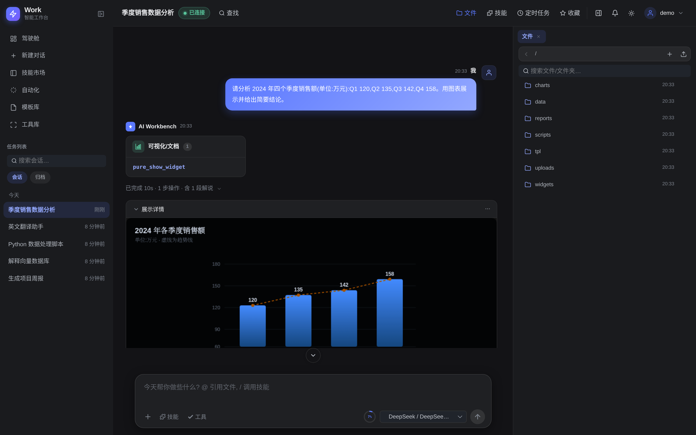
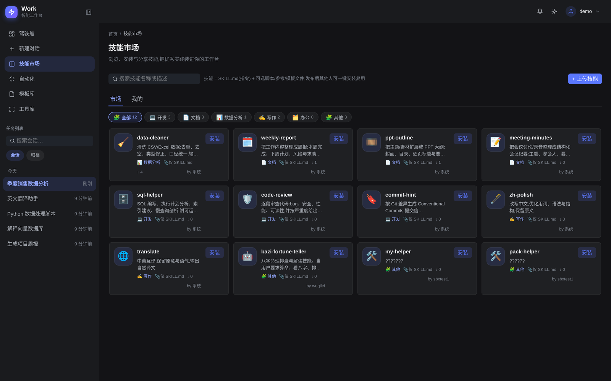
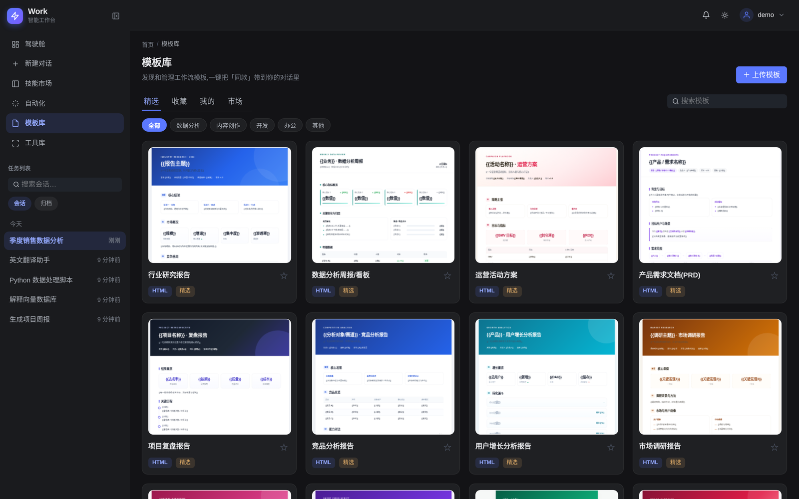
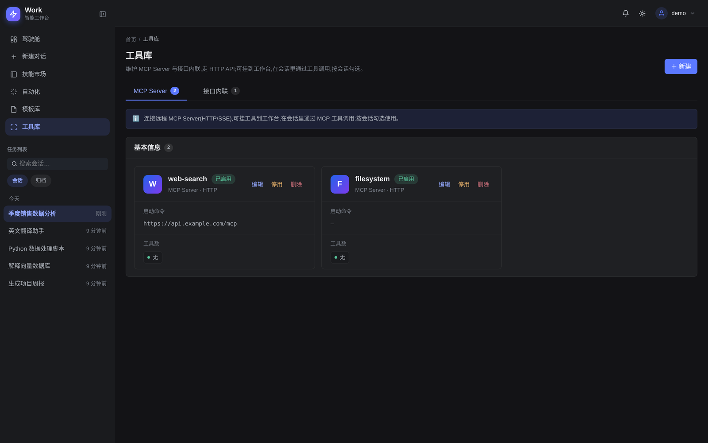
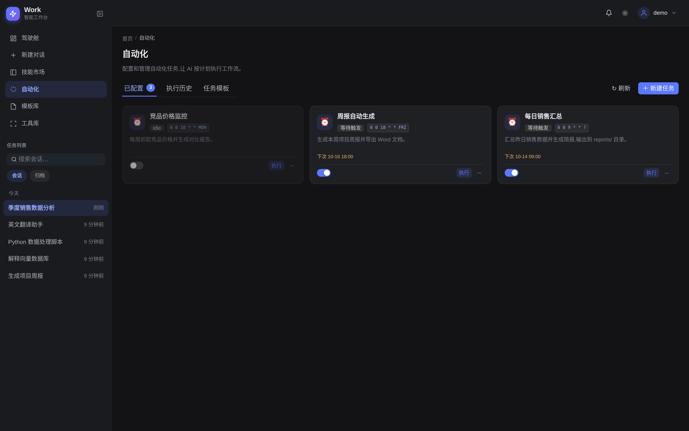
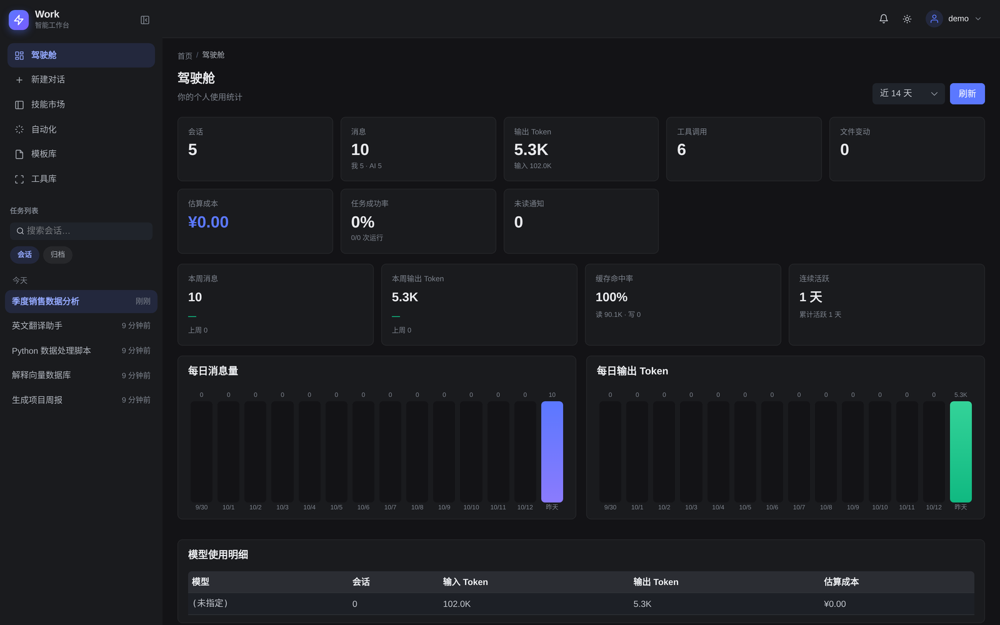
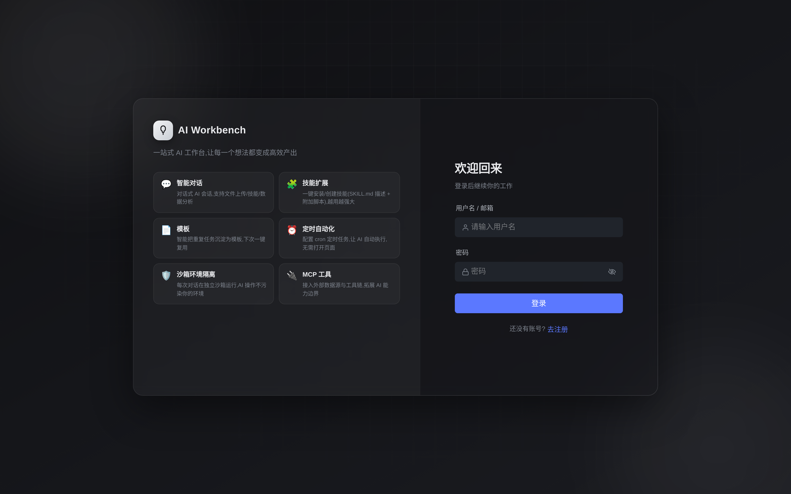

# AI Workbench

[](LICENSE)
[](https://github.com/wuqilei-code/ai-workbench/actions/workflows/ci.yml)

多用户通用 AI 工作台(类 Trae):**对话 + 智能体编排 + 浏览器接管 + 动态 UI 可视化 + 技能/模板体系**一体化。
服务端部署,浏览器访问;多用户注册与会话隔离;每个用户独立工作区与沙箱容器;面向内网私有化部署。

## 界面预览

### 智能对话与动态 UI 可视化
对话即工作台:流式回答、工具调用卡片,以及由 AI 现场生成的交互式图表/组件。



### 技能市场
浏览、安装、分享技能(`SKILL.md` 指令 + 可选脚本/参考/模板),一键装进工作台,按会话勾选加载。



| 模板库 | 工具库(MCP / 接口内联) |
|---|---|
|  |  |

| 定时自动化 | 个人驾驶舱 |
|---|---|
|  |  |

<details>
<summary>登录页</summary>



</details>


## 架构

```
浏览器 ──80──▶ nginx (Vue SPA + /api 反代) ──▶ Spring Boot 网关 (8080)
                                              │  ├─ MySQL 8     用户/会话/消息/模板/技能/任务/通知(含 Flyway 迁移)
                                              │  ├─ SSE         /api/chat/sessions/{id}/events(流式直通)
                                              │  └─ WebClient + X-Internal-Token
                                              ▼
                                        agent-service (FastAPI, 8000)
                                              │  ├─ deepagents(LangGraph)执行轨
                                              │  └─ Postgres   线程 checkpoint / 跨线程 store
                                              ▼
                                        每用户 AIO 沙箱容器(Chromium + VNC + code-server + shell)
```

- **deepagents 单轨**:对话与定时任务都由 agent-service 执行;网关只做鉴权、持久化与 SSE 中转,
  事件(deepagents 原生 `start/delta/tool/tool_result/permission/done` …)原样转发给前端。
- **隔离**:每用户工作区 `/workspace/users/<uid>/project`,被执行沙箱与文件树共享。
- **沙箱**:`execute`/文件/浏览器操作全部在 per-user AIO 沙箱容器内;前端 iframe 内嵌 VNC 画面。
- **跨副本**:定时任务用 DB 分布式锁互斥;会话事件经 `session_event` 出站表按 `seq` 增量中继,
  多副本可并列运行(单机亦可)。

## 技术栈

| 层 | 选型 |
|---|---|
| 前端 | Vue 3 + Vite + TypeScript + Pinia + Naive UI(+ vue-i18n) |
| 网关 | Java 21 + Spring Boot 3.3 + MyBatis-Plus + Spring Security(JWT) + Flyway |
| 智能体 | Python + FastAPI + deepagents(LangGraph) |
| 数据库 | MySQL 8(业务) + Postgres 16(agent checkpoint) |
| 部署 | Docker multi-stage + supervisord + nginx |

## 快速开始

```bash
cd docker
```

**1) 生成 `docker/.env` 并填入随机密钥**(缺失或过短会导致启动失败)。

推荐用内置脚本一键生成(自动复制 `.env.example` 并把 `JWT_SECRET / APP_AES_KEY / INTERNAL_TOKEN / 各数据库密码`填成随机值):

```bash
# Linux / macOS / Git Bash
sh gen-env.sh
```
```powershell
# Windows PowerShell
powershell -ExecutionPolicy Bypass -File .\gen-env.ps1
```

也可手动 `cp .env.example .env` 后按下表填入:

| 变量 | 要求 | 生成命令 |
|---|---|---|
| `JWT_SECRET` | **≥ 32 字节** | `openssl rand -hex 32` |
| `APP_AES_KEY` | Base64 的 32 字节 | `openssl rand -base64 32` |
| `INTERNAL_TOKEN` | 随机 | `openssl rand -hex 32` |
| `SPRING_DATASOURCE_PASSWORD` / `MYSQL_PASSWORD` / `MYSQL_ROOT_PASSWORD` / `POSTGRES_PASSWORD` | 随机 | `openssl rand -hex 16` |
| `AGENT_MODEL` / `AGENT_MODEL_API_KEY` | 模型与 Key | 见模型服务商 |

> Windows 无 `openssl` 时可用 PowerShell,例如 `JWT_SECRET`:
> `-join ((1..32) | % { '{0:x2}' -f (Get-Random -Maximum 256) })`

**2) 拉取每用户「执行沙箱」镜像(约 13GB)并打上默认 tag** —— agent 的
执行命令 / 读写文件 / 浏览器都在该容器内运行,不拉取则这些能力不可用:

```bash
docker pull ghcr.io/agent-infra/sandbox:1.11.0
docker tag  ghcr.io/agent-infra/sandbox:1.11.0 aio-sandbox:latest
# 国内镜像加速:
# docker pull enterprise-public-cn-beijing.cr.volces.com/vefaas-public/all-in-one-sandbox:1.11.0
# docker tag  enterprise-public-cn-beijing.cr.volces.com/vefaas-public/all-in-one-sandbox:1.11.0 aio-sandbox:latest
```

**3) 启动**:

```bash
docker compose up --build
```

- 浏览器打开 `http://localhost:8080/`
- **首个注册用户自动成为管理员**
- 管理员在「管理 → 模型配置」添加 provider/model 并 Apply 后即可对话
- 未拉取沙箱镜像时服务仍可启动、纯对话可用,但**沙箱类工具会失败**(见上)
- 默认自带 MySQL/Postgres 容器,首次启动自动建表(`schema.sql`);如需改用外部 MySQL,把 `.env` 的 `MYSQL_HOST` 指向它

## 本地开发

```bash
# 后端(需 JDK 21+、Maven 3.6+)
cd backend
mvn clean package -DskipTests     # 产物 target/*.jar

# 前端(需 Node 18+)
cd frontend
npm install
npm run dev                       # Vite 代理 /api → localhost:8080
```

> 提示:若本机 Maven 全局 `settings.xml` 使用华为云镜像(`repo.huaweicloud.com`),个别 artifact 可能返回 HTML 错误页导致 `Non-parseable POM`,改用阿里云镜像(`https://maven.aliyun.com/repository/public`)即可。

## 测试与检查(CI 门禁)

```bash
cd backend  && mvn test            # JUnit(令牌/变量替换/内部鉴权/SSE 中继)
cd frontend && npm run typecheck && npm run test && npm run build
cd agent-service && pytest -q      # 沙箱工作区 / 出站 SSRF / 入站来源白名单
```

CI 见 `.github/workflows/ci.yml`(后端 package、前端 typecheck+test+build、agent-service pytest)。

## API 文档

- OpenAPI JSON:`GET /v3/api-docs`
- Swagger UI:`/swagger-ui/index.html`
- 默认开启;如需收敛为"需登录",设 `OPENAPI_ENABLED=false`。
- 除 `登录/注册/健康检查/内部接口` 外,均需 `Authorization: Bearer <JWT>`。

## 配置(环境变量,见 `docker/docker-compose.yml` 与 `docker/.env`)

| 变量 | 说明 |
|---|---|
| `JWT_SECRET` | JWT 签名密钥(`openssl rand -hex 32`;缺失启动失败) |
| `APP_AES_KEY` | AES-256 密钥(Base64 的 32 字节;加密存储 provider key 等) |
| `APP_REGISTRATION_ENABLED` | 是否开放注册(默认 `true`,便于建号;公网部署建议 `false`) |
| `INTERNAL_TOKEN` | app ⇄ agent-service 内部令牌(两服务一致;`openssl rand -hex 32`) |
| `INTERNAL_TRUSTED_CIDRS` | 内部接口可选来源白名单(IPv4/CIDR;空=仅校验令牌) |
| `SSE_RELAY_ENABLED` / `SSE_RELAY_POLL_MS` | 会话事件跨副本中继开关/轮询间隔 |
| `SPRING_DATASOURCE_*` / `MYSQL_HOST` | 业务库连接(dev 默认宿主机 MySQL,经 `host.docker.internal`) |
| `POSTGRES_PASSWORD` | agent checkpoint 库密码 |
| `AGENT_MODEL` / `AGENT_MODEL_BASE_URL` / `AGENT_MODEL_API_KEY` | 模型与密钥 |
| `AGENT_HITL` | 危险操作是否需人工确认(默认 `true`) |
| `AGENT_WORKERS` / `AGENT_MAX_TURNS` | agent 并发 worker / 单请求步数上限 |
| `AGENT_SANDBOX_*` | 沙箱镜像、网络、内存/CPU、空闲回收等 |
| `AGENT_JOBS_*` | 定时任务并发、超时、重试、Webhook、全局暂停 |
| `AGENT_OUTBOUND_ALLOWLIST` / `AGENT_ALLOW_PRIVATE_OUTBOUND` | 出站 SSRF 策略 |

## 目录

```
ai-workbench/
├── docker/         Dockerfile + compose(dev/prod) + supervisord + nginx + prometheus 示例
├── backend/        Spring Boot 3 网关(Maven;db/migration 为 Flyway 迁移)
├── frontend/       Vue 3 + Vite + TS
├── agent-service/  Python FastAPI + deepagents
└── scripts/        备份脚本(MySQL/Postgres/工作区卷)
```

整改与待办清单见 [`TASKS.md`](TASKS.md)。

## 常见问题

- **启动报 `Access denied for user 'aiworkbench'@...` / 数据库密码验证失败**
  MySQL 的 `MYSQL_PASSWORD`/`MYSQL_ROOT_PASSWORD` **仅在数据卷首次初始化时生效**。若之前跑过(存在旧卷)或重新执行过 `gen-env`(生成了新密码),旧卷里的密码与当前 `.env` 不一致就会鉴权失败。解决——删除 MySQL 数据卷后重启(会清空业务库,首次启动自动重建表):

  ```bash
  docker compose rm -sf mysql
  docker volume rm ai-workbench_mysql-data   # 卷名 = ai-workbench_mysql-data
  docker compose up -d
  ```
  > 注意:`docker compose down -v` 会同时删除工作区/Postgres 等**所有**数据卷,谨慎使用。

- **`jwt.secret 必须至少 32 字节`**:`.env` 的 `JWT_SECRET` 太短或仍是占位符,用 `gen-env` 生成或 `openssl rand -hex 32` 填入。

- **沙箱工具报错(执行/文件/浏览器)**:未拉取 `aio-sandbox:latest`(见「快速开始」第 2 步)。

## 贡献

欢迎提交 Issue 与 PR。开始前请阅读:

- [`CONTRIBUTING.md`](CONTRIBUTING.md) — 开发环境、CI 门禁与提交规范
- [`CODE_OF_CONDUCT.md`](CODE_OF_CONDUCT.md) — 社区行为准则
- [`SECURITY.md`](SECURITY.md) — 漏洞披露方式与部署安全须知

## 许可证

本项目以 **Apache License 2.0** 发布,见 [`LICENSE`](LICENSE)。
内置的开源字体 Noto Sans SC 等第三方资产的许可见
[`THIRD_PARTY_NOTICES.md`](THIRD_PARTY_NOTICES.md)。
