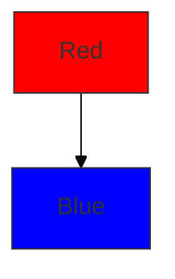

# Mermaid Syntax Rules

## Common Errors and Fixes

### 1. List Syntax Conflict
```
❌ [1. Step] → Triggers "Unsupported markdown: list"
✅ [1.Step] or [① Step] or [(1) Step]
```

### 2. Subgraph Naming
```
❌ subgraph My Group
✅ subgraph group["My Group"]
```

### 3. Special Characters in Node Text
- Use quotes for text with spaces: `["Text with spaces"]`
- Replace `"` with `『』`
- Replace `(` with `『` and `)` with `』`

### 4. Arrow Types
- `-->` solid arrow
- `-.->` dashed arrow
- `==>` thick arrow
- `~~~` invisible link

### 5. Node Shapes
- `[Rectangle]` - default
- `(Rounded)` - rounded corners
- `((Circle))` - circle
- `{{Hexagon}}` - hexagon
- `[/Parallelogram/]` - parallelogram
- `[\Parallelogram alt\]` - alt parallelogram
- `>Asymmetric]` - asymmetric
- `[[Subroutine]]` - subroutine
- `[(Cylinder)]` - cylinder
- `{{Database}}` - database

### 6. Styling


### 7. Chinese Text
- Use quotes for Chinese text: `["中文文本"]`
- Avoid special characters in Chinese text
- Use `<br/>` for line breaks in nodes
